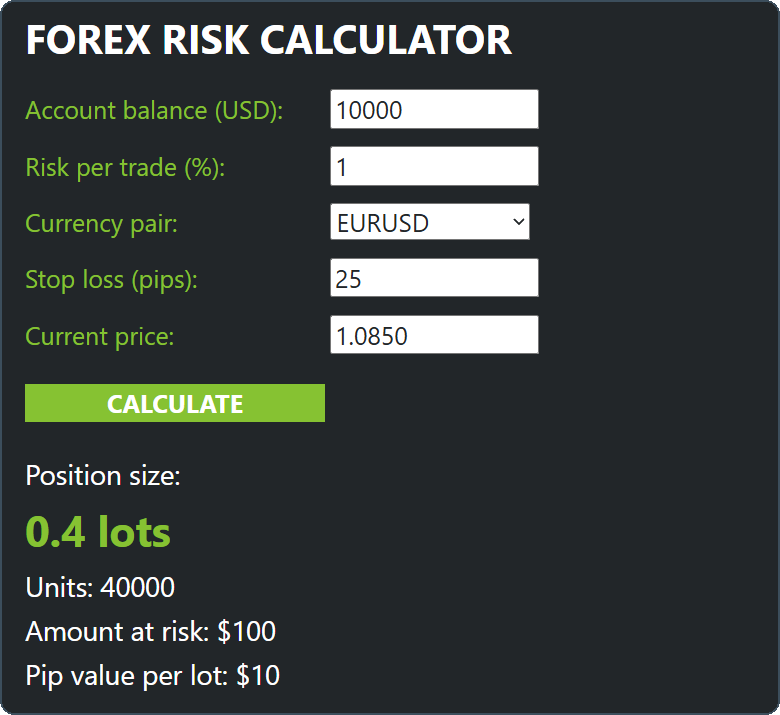
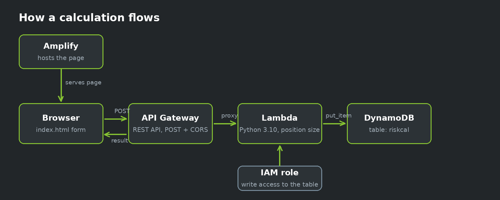
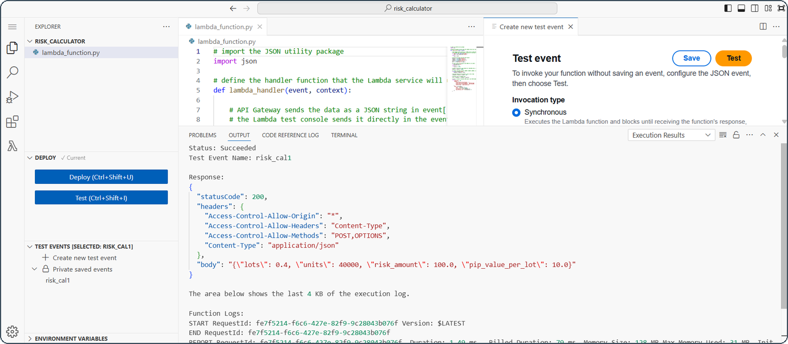
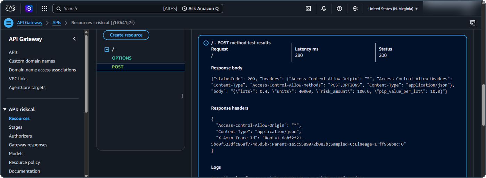
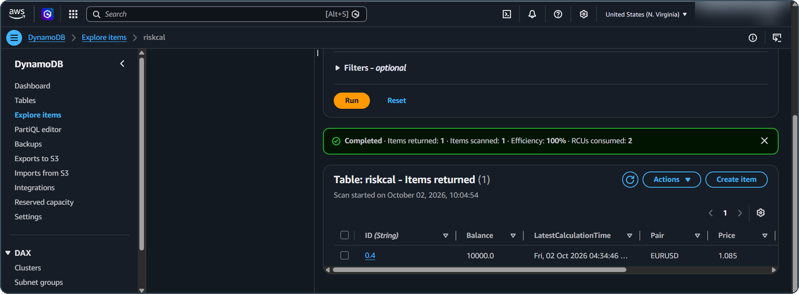
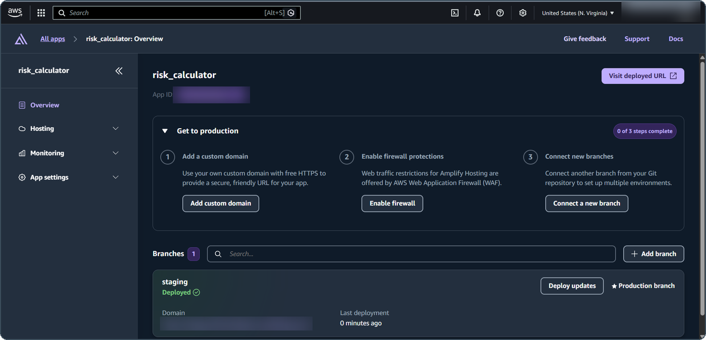

<p align="center">
  
</p>

<p align="center">
  
  
  
  
  
</p>

A serverless web app that tells a forex trader **how many lots to trade so one trade risks exactly the amount they chose**. Enter your account details and stop loss, get the position size back, and every calculation is saved to a database.

## Demo

<p align="center">
  
</p>

A $10,000 account, 1% risk, EURUSD, 25 pip stop at 1.0850 gives **0.4 lots**, **$100 at risk** and **$10 per pip per lot**.

## Architecture

<p align="center">
  
</p>

| Layer | Service | Job |
|-------|---------|-----|
| Frontend | AWS Amplify | Hosts the static `index.html` page |
| API | Amazon API Gateway | Receives the POST request and handles CORS |
| Logic | AWS Lambda (Python 3.10) | Calculates the position size |
| Storage | Amazon DynamoDB | Saves each calculation |
| Security | AWS IAM | Lets the Lambda write only to its own table |

## Proof it works

Each layer tested on its own, then end to end.

**1. Lambda test passes**



**2. API Gateway returns 200**



**3. The result is saved in DynamoDB**



**4. The page is live on Amplify**



## The math

```
risk amount = balance x risk% / 100
pip value   = pip size x 100,000        (pip size: 0.0001, or 0.01 for JPY pairs)
pip value   = pip value / price         (only when USD is the base currency, e.g. USDJPY)
lots        = risk amount / (stop loss pips x pip value)
```

Supported pairs: EURUSD, GBPUSD, AUDUSD, NZDUSD, USDJPY, USDCHF, USDCAD. The calculator assumes a USD account.

## API

**Request** `POST`

```json
{
  "balance": 10000,
  "risk_pct": 1,
  "pair": "EURUSD",
  "stop_pips": 25,
  "price": 1.0850
}
```

**Response**

```json
{
  "lots": 0.4,
  "units": 40000,
  "risk_amount": 100.0,
  "pip_value_per_lot": 10.0
}
```

## Repository contents

```
.
├── index.html            frontend page (set API_URL before deploying)
├── lambda_function.py    Lambda handler
├── iam-policy.json       DynamoDB permissions for the Lambda role
├── screenshots/          images used in this README
└── README.md
```

## Deploy it yourself

1. **DynamoDB:** create a table named `riskcal` with partition key `ID` (String).
2. **Lambda:** create a Python 3.10 function, paste in `lambda_function.py`, and deploy it.
3. **IAM:** add `iam-policy.json` to the Lambda's execution role as an inline policy, replacing `YOUR-ACCOUNT-ID` with your AWS account ID.
4. **API Gateway:** create a REST API with a `POST` method using Lambda proxy integration. Enable CORS, then deploy to a stage such as `prod`.
5. **Frontend:** set `API_URL` in `index.html` to your invoke URL.
6. **Amplify:** zip `index.html` (as the only file at the top level of the zip) and upload it with manual deployment.

## What I learned

- Lambda proxy integration passes the body as a string in `event['body']`, and the function must return the status code and headers itself.
- Browsers block calls to another origin unless CORS is enabled, and the API must be redeployed after changing it.
- DynamoDB does not accept Python floats, so numbers are stored as strings (or `Decimal`).
- IAM execution roles decide what a Lambda can reach, so the function needs an explicit DynamoDB policy.

## Known limitations and next steps

- [ ] The `ID` key is the calculated lot size, so two trades of the same size overwrite each other. A unique ID per calculation would keep full history.
- [ ] CORS is set to `*` for testing. Restrict it to the Amplify domain for production.
- [ ] Only USD accounts and USD pairs are supported. Cross pairs like EURGBP need an extra conversion rate.
- [ ] Add take-profit and risk-reward ratio, a history view that reads from DynamoDB, and authentication.

## Clean up

Delete the Amplify app, the API Gateway API, the Lambda function, the DynamoDB table and the IAM role when you finish, so nothing keeps running in your account.

## Credits

The project structure follows a serverless web app tutorial on AWS (Amplify, Lambda, API Gateway and DynamoDB). I adapted it into a forex risk calculator with my own logic, interface and data model.

## Disclaimer

This is a learning project and not financial advice. Check any position size against your broker's contract specifications before trading.
